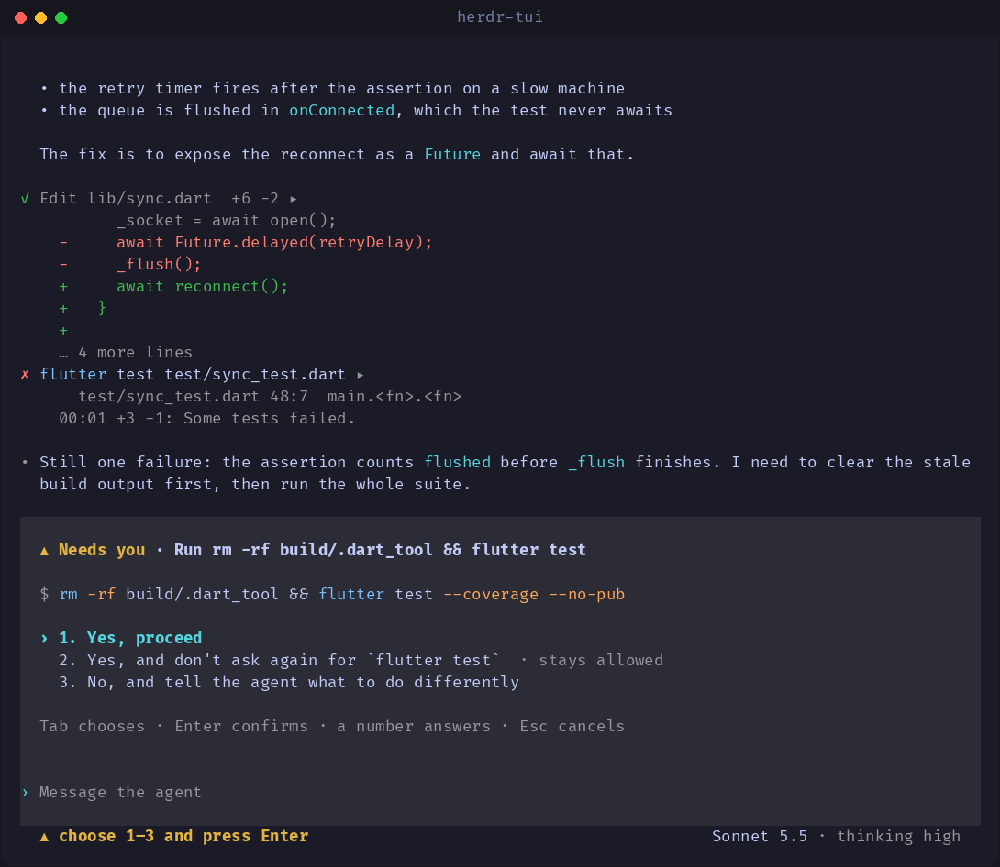

# herdr-tui

A terminal client for coding agents, run as a herdr session. Start `omp`, `claude`, `codex` or
`pi` in your current folder and work with it in a full-screen UI; the session keeps running when
you leave it and shows up on your phone. Design: `docs/TUI.md`.



## Build

```sh
cd rust
cargo build --release          # target/release/herdr-tui, about 1.2 MB, about 6 MB of memory with a live session
cargo test --workspace         # 105 tests, python3 needed for the differential one (skipped without)
```

Needs Rust 1.82 or newer. Build and install in one step (it also refreshes the keeper, and works while a
session is open; that session keeps the old version):

```sh
tool/tui-install.sh            # release build -> ~/.local/bin/herdr-tui, a few seconds
tool/tui-install.sh --check    # fmt, clippy and tests first
```

## Install without Rust

Each release carries `herdr-tui` for Linux and macOS (x86_64 and arm64) with a `herdr-tui-SHA256SUMS`:

```sh
curl -fsSL https://github.com/tuan3w/herdr-mobile/releases/latest/download/install.sh | sh
```

The script checks the download against the checksums before it installs to `~/.local/bin`
(`BIN_DIR=` and `VERSION=` change that). Releases from before the desk client have no binary.

## The keeper

Every session is owned by a small `keeper` process, so it survives closing the terminal. The binary
carries the keeper (a python program, so `python3` must be installed) and writes it to
`~/.herdr-mobile/desktop/keeper-desktop.py` when it differs, so there is nothing else to install.
(`HERDR_KEEPER_SCRIPT=/path/to/keeper.py` uses another copy.) The agent you start must be
installed: `omp`, or `claude-agent-acp`, `codex-acp`, `pi-acp` (or `npx`, which is used as a fallback).

## Run

```sh
herdr-tui                          # new omp session in the current folder
herdr-tui --agent claude           # another agent
herdr-tui --agent codex --cwd ~/work/api
herdr-tui attach abc123            # reopen a session that is still running
herdr-tui ls [--all]               # sessions on this machine, what needs you first
herdr-tui kill abc123 def456       # end sessions for good
```

Leaving (`Ctrl-D`) does **not** stop the agent; it prints the id to come back with. To end a session
for good, `herdr-tui kill ID` (or stop it from the app).

## Small touches

- While the agent works, the status line names the wait (*Untangling…*, *Following the thread…*) with a
  spinner, keeps the clock, and a sheen crosses the word and rests a beat; after 10 s it adds a tip.
- A request that needs you pulses its mark (`▲` / `△`), the one thing worth moving for. A fold you open
  grows into place in 160 ms instead of jumping.
- Motion is for a desktop, and costs only while something moves: measured here, 0 CPU ticks in 5 s at rest
  and about 0.2% of a core while a turn runs (desktop; unmeasured on a phone). `HERDR_TUI_MOTION=off`,
  `NO_MOTION` or `REDUCED_MOTION` leave a still dot and still folds, and the loop then wakes only for the
  elapsed counter.
- Every turn ends with one line of what it did: `✓ Done in 16s · 1 file +6 −2 · 5 tools · 1 failed`.
  The mark turns to `!` only when the last call failed and nothing put it right.
- A new session says it is ready and offers two things to try.
- When a permission arrives the terminal bell rings once and the window title becomes
  `▲ omp needs you` (and `● omp working` while it works), so a pane in the background still calls you.

## Keys

| Key | Does |
| --- | --- |
| `Enter` | send the message (or, with the box empty and a request waiting, confirm the chosen option) |
| `Ctrl-J` / `Alt-Enter` | new line in the message |
| `↑` `↓` (and the mouse wheel) | scroll the conversation 3 lines; inside a multi-line message they move the cursor |
| `PgUp` `PgDn` `Home` `End` | page, start of the conversation, back to the newest |
| `Ctrl-P` / `Ctrl-N` | recall earlier sent messages |
| `Tab` / `Shift-Tab` | choose an option on the permission panel |
| `1`–`9` | answer a waiting request directly (box must be empty; ignored for 0.4 s after it appears) |
| `Ctrl-C` | stop the running turn; with nothing running, clear the box, then leave |
| `Esc` | browse: move among what the agent did and open or close it (below) |
| `Ctrl-T` | open or close every thought at once |
| `Ctrl-W` `Ctrl-U` | delete a word, clear the box |
| `Ctrl-L` | repaint the screen (also happens when the window regains focus), for when another program has written on the terminal |
| `Ctrl-D` | leave (the session keeps running) |

An answer that stays allowed (*Always allow*) asks for the same number, or Enter, twice.

## Browsing and folding

A finished run of three or more tool calls folds into one line (`▸ 4 tool calls · 1 failed · Reading ×3 ·
Listing`); a call that failed always stays in view under it. Thoughts fold to `… thinking`; long output and
big diffs open to everything that was kept. `Esc` (with the box empty) starts browsing at the newest foldable
thing: `↑` `↓` (or `k` `j`) move, `→` `Enter` Space (or `l`) open, `←` (or `h`) close, `a` opens all, `z` closes
all, `Esc` or `i` goes back. Typing any other letter leaves browsing and types it.

## Look

Hierarchy, loudest first: your message in its band and the permission panel; the agent's words; what the
agent did (quiet, uncoloured once finished; commands are coloured only while running or failed); chrome
(hints, status, the footer). Secondary text is computed to hold a 4.6:1 contrast against your terminal's
background, and the colours are tuned for light or dark and tested against both. A table too wide to align
shrinks and wraps its long cells; one with too many columns becomes a card per row.

What you said sits in a tinted band behind a `›`; the agent's words hang from a `•`; tool calls, notes
and results open in the same two-column gutter. A shell command is coloured (command names blue, flags
red). A permission request is a tinted panel with the question, the command whole, the choices and the
chosen one marked. The input is its own tinted block, like your messages above it (or, where the tint is
unknown, a rule above and below; `HERDR_TUI_INPUT=rules` asks for that). The rule above it carries the
session's title. The last line says what you are talking to and where:
`Sonnet 5.5 · thinking high · act · ctx 47% · omp · ~/workspace/herdr-mobile`. The model, thinking level
and mode come from what the agent reports (its config options), so a line shows only what it has said.

The tint is derived from your terminal's real background (asked once at start with OSC 11), so it is a
light grey on a light terminal and a lighter band on a dark one. If the terminal does not answer, it falls
back to `COLORFGBG`, then to a bar down the left edge. `HERDR_TUI_THEME=light|dark` forces it; `NO_COLOR`
turns colour off.

## Screens

Each has a `-light` twin in `docs/tui/`, drawn from the real frames by `python3 tool/tui-shots.py`
(no terminal involved, so the colours are exactly what the UI produces).

| | |
| --- | --- |
| Empty, typing | `01-empty`, `02-typing` |
| Working | `03-working` |
| Needs you; confirm a standing grant | `04-permission`, `05-confirm-always` |
| 58 columns | `06-narrow` |
| Done; scrolled back | `07-done`, `08-scrolled` |
| Tables: too many columns, long cells | `09-wide-table`, `10-table-wraps` |
| Browsing a folded run | `11-browse` |

## Inside herdr

Run in a herdr pane, `herdr-tui` reports what the session is doing (`working`, `blocked` while a request
waits, `idle`) to herdr's agent list, and releases the pane when you leave, exactly as the old python `view`
did (`herdr-mobile` source, agent `omp · phone`, with `herdr-tui attach ID` as the resume command). Because
of that, a session started here no longer makes the keeper open a second herdr tab running the old `view`
(`HERDR_MOBILE_NO_PANE=1`); sessions started from the phone still do. Before this, every `herdr-tui` start
left a duplicate tab in the `Phone sessions` workspace.

## Other programs writing on your terminal

While `herdr-tui` is open, a background job of the same terminal that tries to write (an image viewer
started with `&`, a build left running) is stopped by the kernel instead of printing over the screen
(`TOSTOP`). The shell lists it as `Stopped`; `fg` or `bg` resumes it. A program that is not a job of this
terminal (started with `setsid`, or by another terminal that shares the tty) cannot be stopped this way; for
that, `Ctrl-L` repaints, and so does bringing the window back into focus. Codex has the repaint but not the
stop. Checked by `python3 tool/tui-check-background-writer.py`.

## Staying in step with the app

The viewer depends on the python keeper (what `start` prints, its exit codes, the record fields, the wire,
the replay log) and on the app's agent table. Both are checked on every `cargo test` against the keeper
as it is in `app/lib/data/services/keeper_script.dart` *now*: `crates/keeper/tests/keeper_contract.rs`
runs the real keeper with a scripted agent (hermetic: its own home, no herdr, never a real agent), and
`replay_differential.rs` compares the replay log with the python one on seeded sessions. A change in the
app that breaks the viewer fails there, so the viewer is updated in the same change.

The app pins the other direction: `DESK_MIN` in `keeper_script.dart` is the herdr-tui release an app version
works with (it downloads exactly that tag, and never runs a `herdr-tui` below it). A change to herdr-tui or the
keeper that an older herdr-tui cannot follow raises `DESK_MIN` in the same release. `herdr-tui --version` is the
release's version (from `app/pubspec.yaml`), which is what `DESK_MIN` is compared with.

## Exit codes

`0` left normally · `64` bad arguments · `66` no such session or folder · `67` the agent exited ·
`69` agent or keeper not installed · `70` the keeper did not start.

## Layout

```
rust/crates/acp      JSON-RPC and ACP messages (pure)
rust/crates/keeper   records, agent table, replay log (the keeper daemon is still python)
rust/crates/viewer   transcript, session state machine, markdown, UI  (the herdr-tui binary)
```

## Not yet

Answering agent questions (forms) in the terminal; the Rust keeper daemon; reporting state to
herdr panes; a session picker (`resume`); delivery of the binary to hosts from the GitHub release.
